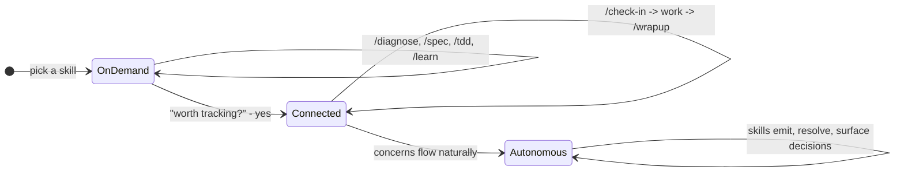

# Contributing

How waypoint-skills works internally.
Read this if you want to understand the architecture, add a skill, or modify the tracking system.

## Process and adapter split

Each skill has two layers:

1. **Process document** (`process/*.md`) - the methodology, tool-agnostic. Works as a human checklist, a team playbook, or an AI instruction set.
2. **Adapter** (`task/{skill}/SKILL.md`, `project/{skill}/SKILL.md`, or `adapters/{tool}/`) - thin file that references the process doc and adds tool-specific execution notes.

| Process document | Methodology | Adapter skills |
|-----------------|-------------|----------------|
| [process/debugging.md](process/debugging.md) | 7-phase debugging discipline | /diagnose |
| [process/requirements.md](process/requirements.md) | Requirements grilling and spec writing | /spec |
| [process/tdd.md](process/tdd.md) | Test-driven development | /tdd |
| [process/architecture-review.md](process/architecture-review.md) | Architecture assessment | /improve-codebase-architecture |
| [process/learning.md](process/learning.md) | Structured technical learning | /learn |

Not every skill has a process doc.
Some are too thin (/grill-me is a 13-line instruction) or too tool-specific (/prototype has three execution branches that depend on the agent model).

## Directory structure

```
task/           # Skills that do work (diagnose, spec, tdd, etc.)
project/        # Skills that manage projects (check-in, wrapup, migrate, etc.)
process/        # Tool-agnostic methodology documents
templates/      # Shared file templates (feature specs, logic docs, glossary)
adapters/       # Platform-specific adapters (cursor, opencode, codex)
internals/      # System design docs (concepts, engagement model)
```

Task skills work standalone with no project context.
Project skills become more useful when project docs (SCOPE.md, CONCERNS.md, etc.) exist.

## Frontmatter Schema

Every `SKILL.md` must declare exactly these required fields:

```yaml
---
name: skill-name                    # Required. Kebab-case.
description: "One-line description" # Required. Used for routing and discovery.
status: stable | draft | experimental  # Required.
user-invocable: true | false        # Optional. Default: true.
---
```

`user-invocable: false` marks a skill that should not be triggered directly by user request or model inference - typically a utility skill that another skill orchestrates internally.
Omit `user-invocable` entirely for the common case where a skill is freely invocable - it defaults to `true`.

All other frontmatter fields (`metadata.hermes`, `inputs`, `outputs`, `signals`, etc.) are optional and skill-specific.
Keep them as needed for routing metadata or workflow bookkeeping.

## SKILL.md body contract

The body is what Claude Code auto-loads on skill invocation.
Every line costs tokens on every invocation, so the body must be lean.

**Line budget:** target 50-80 lines, max 100.
CI warns at >80 and fails at >100.

**Structure:**

```
---
name, description, status
---
{Instructions start here. Sequential. No preamble header.}

## {Skill-specific sections only where genuine logical break}

Does NOT: {boundary, if non-obvious from description}

## Engagement
{declaration only - 3-5 lines}

## Exit
{2-4 bullets - handoff targets}

## Tone
{1 sentence}
```

**Rules:**

- No H1 header. Frontmatter `name` + directory is identity.
- No `## On invocation` header. The body runs on invocation - sequential execution is assumed.
- No opening paragraph restating the description. Frontmatter `description` is authoritative.
- Body opens with the first actionable instruction, not a boundary statement.
- Boundaries ("Does NOT:") go near the bottom (before ## Engagement) and only when the boundary is non-obvious from the description. If the description says "output a spec file," you don't need "Does NOT implement."
- `## Tone` is mandatory (1 sentence).
- `## Exit` is mandatory (2-4 bullets) unless the skill has a natural completion message that serves as exit.

## Content ownership

Every piece of instruction content has exactly one authoritative location.
SKILL.md may **declare** (what this skill does differently) but never **define** (restate shared protocol).

The same single-source rule governs computed values, not just prose.
The `autonomy` axis (afk/hitl) is defined once in ENGAGEMENT-REFERENCE.md section 13 and authored per-input by exactly one skill each (`breakdown` tags slices, `wrapup` reports blocking concerns).
Every other skill **cites, never recomputes**: it renders the authoring skill's output and never re-runs the derivation from raw state.
A skill that lacks an authoritative rendering treats the value as `hitl` rather than computing its own.

| Content type | Authoritative location | SKILL.md contains |
|-------------|----------------------|-------------------|
| Engagement protocol | ENGAGEMENT-REFERENCE.md | Declaration only (emits, writes, override) |
| Autonomy axis | ENGAGEMENT-REFERENCE.md section 13 | Citation only (render the value, never recompute it) |
| Load-bearing globs | DEPLOY.md (per project) | Citation only (read the globs, never hardcode a danger list) |
| Review safety invariant | ENGAGEMENT-REFERENCE.md section 14 | Citation only (obey the five crossings, never restate or weaken them) |
| Skill hints mechanic | CONCEPTS-REFERENCE.md | Integration point ("during Step N") |
| Exit handoffs | SKILL.md | 2-4 bullets, unique per skill |
| Tone | SKILL.md | 1 sentence, mandatory |
| Routing/purpose | Frontmatter description | Nothing restated in body |
| Boundaries | SKILL.md near bottom | "Does NOT:" line, only when non-obvious from description |

## Directive verbs

How SKILL.md references other files determines whether they're loaded on invocation.

**Skill-specific reference** (reference/*.md, phases/*.md) - imperative directive:
```
Read [reference/priority-stack.md](reference/priority-stack.md) before proposing work.
```
The agent must read the file. Silent degradation risk is too high for optional loading.

**Shared infrastructure** (internals/*.md, process/*.md) - declaration + on-demand:
```
See [ENGAGEMENT-REFERENCE.md](../../internals/ENGAGEMENT-REFERENCE.md) for the full protocol.
```
The agent consults on demand when performing an engagement action, not on every invocation.
This preserves the token savings from engagement deduplication.

## Subfolder convention

Skills with supplementary files organize them into exactly two subfolder types:

| Subfolder | Semantic | When to use |
|-----------|----------|-------------|
| `phases/` | Routed one-at-a-time based on current state | Phase files, wave files, branch files |
| `reference/` | Conditionally loaded material | Priority stacks, format specs, methodology |

Concept-specific names go in the filename, not the directory.
Design's waves become `phases/wave-1-soul.md`.
Prototype's branches become `phases/logic.md`, `phases/ui.md`.
Format specs (ADR, glossary) go in `reference/`.

No other subfolder types (`waves/`, `branches/`, `formats/`).

## Tracking with Concerns

Skills can optionally track what a project doesn't know yet, is assuming, or has identified as wrong - in a single file called `CONCERNS.md`:

```markdown
### C-041 [open] Should status changes require a confirmation dialog?
type: question | raised: 2026-07-18
Legacy app confirms before status transitions. Our rebuild doesn't. Intentional or gap?
```

Four types of concern: **questions** (need a decision), **assumptions** (working theories to validate), **issues** (something looks wrong), **milestones** (checkpoints grouping specs and handoffs).

Skills read from and write to this file. Humans read from and write to this file.
It is a markdown document - no special tooling required.

You don't need CONCERNS.md to use the skills.
Task skills work standalone.
Project skills become more useful when concerns exist to operate on.

See [CONCERNS-FORMAT.md](CONCERNS-FORMAT.md) for the full specification.

## Engagement model

How the system deepens over time:



**On demand** - invoke a skill, it does the work, done. No setup, no project context needed.

**Connected** - a skill discovers something worth remembering across sessions. You say yes, it writes a line to `CONCERNS.md`. Now `/check-in` reads what's open and proposes work. `/wrapup` resolves concerns after implementation. Sessions link together.

**Autonomous** - concerns flow naturally. Skills emit them during work, resolve what they can, and only surface what needs your judgment.

Each stage includes the previous one. Structure accumulates when it helps and stays out of the way when it doesn't.

### Engagement declaration in SKILL.md

The `## Engagement` section in each SKILL.md is a pure declaration - only fields where this skill diverges from the shared protocol:

```markdown
## Engagement
See [ENGAGEMENT-REFERENCE.md](../../internals/ENGAGEMENT-REFERENCE.md) for the full protocol.
Emits: concerns (type: issue, question)
Writes: none
Override: commit-producing skill - follows exit protocol (section 6)
```

3-5 lines per skill. No boilerplate (nudge protocol, concern format, prohibitions, claims check).
Those are shared protocol defined in ENGAGEMENT-REFERENCE.md.

The `Writes:` line is lint-enforced (`lint-skills.sh`), because it is the frontmatter half of the section 15 manifest and a dishonest one lets a skill skip its receipt:
- `Writes: none` is only valid when the skill writes no repo files. If frontmatter `outputs:` names any artifact other than `concerns` (an inventory marker, a workflow record, a doc), `Writes:` must name it too.
- Any skill whose `Writes:` is not `none` must cite section 15 from its Exit, or its manifest never fires at run time.
Concern emission is declared under `Emits:`, not `Writes:` - appending a concern is not a repo-file write for manifest purposes (ENGAGEMENT-REFERENCE.md section 15.2).

## The outbound seam

Waypoint's inner loop ends at `/wrapup` - local, offline, concerns resolved.
`/ship` is the one outbound verb: it assembles a spec-grounded PR and proposes an `afk | hitl` routing, then hands off to a delivery target.

Two invariants govern anything added to this seam:

- **Waypoint proposes, the target disposes.** `/ship` never holds merge authority. `afk` is necessary, not sufficient, for an unattended merge - it means only "propose the auto lane and open the PR." The delivery target's own enforcement (server-side rulesets, blocking CI, an autonomous reviewer) is the authority, evaluated on the final diff at merge time. A skill on this seam must never imply `afk` means merged.
- **Intent is spec-derived, never diff-derived.** The PR's `## Intent` block traces to the spec, ADRs, and resolved concern decisions - never to a reading of the diff, which would grade the diff against itself.

`DEPLOY.md` is the per-project delivery config, sibling to `ARCHITECTURE.md`: architecture says how the system is built, deploy says how a change reaches production.
Its `load-bearing` glob list is the authoritative source for which paths force `hitl`; skills read it and never hardcode a danger list.
The list is deny-only - it can force `hitl` earlier but can never grant `afk` - which is safe precisely because Waypoint holds no merge authority.
The glob dialect is pinned in ENGAGEMENT-REFERENCE.md section 13.4; the axis it feeds is defined in section 13.

## The review safety invariant

`/review` and the loop-back read text Waypoint did not author (a repo's diff, a reviewer's comments, a repo's own `.claude/agents/`), and on a pull request that text is untrusted.
Any skill that touches review must obey the five-crossing rule defined in ENGAGEMENT-REFERENCE.md section 14: untrusted text never reaches a position that steers a later turn.
The five crossings and their gates, one line each:

- **Finding to concern:** never auto-written (a human pick, at every tier including Tier 3); every field is a structural coordinate (file, line) or a fixed-vocabulary value, never free text the finding supplied, quoted or paraphrased. A review-sourced concern omits section 4's free-text context field.
- **Auto-invoked persona:** trusted-tier only (built-in or user-global `~/.claude/agents/`), read by absolute path. Waypoint sources personas from the trusted tiers on every path; a repo's own `.claude/agents/` is never a Waypoint persona source, by hand or auto.
- **Behavior-escalating setting** (e.g. auto-run review): trusted config only, never a file in the repo under review.
- **Fix output:** a formatter or linter autofix is an ordinary gated diff - same build, same review; there is no mechanical bypass.
- **Observed content to note:** the user's personal note in the trusted global config is written only from the user's own chat input on confirmation, never from observed content (a repo file, diff, comment, page, or tool result); a preference inferred from the material under review never enters it without a fresh confirmation.

Trusted means the skill family's built-ins and the user's personal global config (written only from the user's own chat input on confirmation); everything inside the repo under review is untrusted, judged by author not by content.
The same chat-confirmed rule governs everything you author in that user-global trusted config - switches, reviewed-state, personas, and the personal note - so nothing there is ever set from a repo (ENGAGEMENT-REFERENCE.md section 14.1).

### Authoring a persona

A persona is a lens - a name plus a set of questions the review asks, a weighting over the standard categories. The machinery is identical across personas; only the questions change.
Author a built-in as a file in `task/review/reference/personas/` (name, one-line identity, a short list of lens questions); it ships trusted with the skill family.
A personal lens is an agent in your `~/.claude/agents/`, authored through the grill (`task/review/reference/persona-grill.md`), which forces a domain, three failure modes, a lens boundary, and a citation basis and refuses an ungrounded vibe lens.
Waypoint ships no shared persona document: there is no `PERSONAS.md`. The two tiers Waypoint sources, both trusted:

- **Built-in** (`reference/personas/`) - trusted; ships with the skill.
- **User-global** (`~/.claude/agents/`, outside any repo) - trusted.

Waypoint composes a persona only from these two tiers, by absolute path, on every path - manual or automatic - so a repo's own `.claude/agents/` can never become a review lens (a repo shares the agents directory name, so Waypoint never dispatches a bare name for the host to resolve). A repo's lens is untrusted; to use one, copy it into `~/.claude/agents/`. See ENGAGEMENT-REFERENCE.md section 14 and `task/review/reference/personas.md`.

## Multi-phase workflows

/migrate and /buildout have phase tracking for large efforts.
These are optional - you can start with /create and upgrade later.

| Workflow | Phases | When to use |
|----------|--------|-------------|
| /migrate | 7 phases (docs sprint through cutover) | Replacing an existing system |
| /buildout | 4 phases (discovery through iterate-and-ship) | Building a new product |
| /create | No phases | Adding features to an existing codebase |

## Branching

- `main` - stable, deployed via `sync-skills.ps1`. Plugin installs pull from here.
- `revisions` - local development branch. Specs, drafts, and in-progress work live here.

All skill changes land on `main` directly (single contributor, no PR gate).
The `revisions` branch holds design specs (`specs/`) and working drafts that shouldn't ship.

## Local development

Clone the repo:

```bash
git clone git@github.com:max-zhu-bv/waypoint-skills.git
```

Deploy to `~/.claude/`:

```bash
.\sync-skills.ps1
```

The sync script copies skills (flattened from `task/`, `project/`, `in-progress/`, `third-party/` into `~/.claude/skills/`), shared infrastructure (`internals/`, `templates/`, `process/` into `~/.claude/`), and root files (`CONCERNS-FORMAT.md`, `README.md` into `~/.claude/skills/`).

After editing a skill, re-run `sync-skills.ps1` to deploy.
The CI lint check (`lint-skills.sh`) validates two things:
- Line counts: warns >80, fails >100.
- The `Writes:`/manifest convention (see "Engagement declaration in SKILL.md"): a declaration must be honest and manifest-linked, so a nonstandard one can never silently skip the section 15 manifest.

### The flatten invariant

The flatten is load-bearing and unchecked by CI (lint counts lines, not link resolution).
A skill's `../../internals/X.md` link resolves in both the repo layout (`project/{name}/SKILL.md`) and the installed layout (`skills/{name}/SKILL.md`) only because a `SKILL.md` always sits exactly two levels above the shared-infra root.
So: no skill may nest a `SKILL.md` deeper than `{group}/{name}/SKILL.md`, and no shared doc may move under `skills/`.
Break either and every `../../` link in that skill silently 404s on install while still resolving in the repo, so the CI and local checks both stay green.
A CI link-resolution check is a planned follow-up; until it exists, this invariant is enforced by convention.

## Design references

- [internals/CONCEPTS-REFERENCE.md](internals/CONCEPTS-REFERENCE.md) - Documentation Map, Resolution Cascade, Single-Writer, naming classes
- [internals/ENGAGEMENT-REFERENCE.md](internals/ENGAGEMENT-REFERENCE.md) - Tier detection, nudge protocol, concern emission rules
