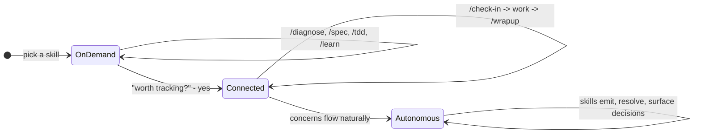

# Contributing

How waypoint-skills works internally.
Read this if you want to understand the architecture, add a skill, or modify the tracking system.

## Process and adapter split

Each skill has two layers:

1. **Process document** (`process/*.md`) - the methodology, tool-agnostic. Works as a human checklist, a team playbook, or an AI instruction set.
2. **Adapter** (`task/{skill}/SKILL.md`, `project/{skill}/SKILL.md`, or `adapters/{tool}/`) - thin file that references the process doc and adds tool-specific execution notes.

| Process document | Methodology | Adapter skills |
|-----------------|-------------|----------------|
| [process/debugging.md](process/debugging.md) | 7-phase debugging discipline | /diagnose |
| [process/requirements.md](process/requirements.md) | Requirements grilling and spec writing | /spec |
| [process/tdd.md](process/tdd.md) | Test-driven development | /tdd |
| [process/architecture-review.md](process/architecture-review.md) | Architecture assessment | /improve-codebase-architecture |
| [process/learning.md](process/learning.md) | Structured technical learning | /learn |

Not every skill has a process doc.
Some are too thin (/grill-me is a 13-line instruction) or too tool-specific (/prototype has three execution branches that depend on the agent model).

## Directory structure

```
task/           # Skills that do work (diagnose, spec, tdd, etc.)
project/        # Skills that manage projects (check-in, wrapup, migrate, etc.)
process/        # Tool-agnostic methodology documents
adapters/       # Platform-specific adapters (cursor, opencode, codex)
design/         # System design docs (concepts, engagement model)
```

Task skills work standalone with no project context.
Project skills become more useful when project docs (SCOPE.md, CONCERNS.md, etc.) exist.

## Tracking with Concerns

Skills can optionally track what a project doesn't know yet, is assuming, or has flagged as wrong - in a single file called `CONCERNS.md`:

```markdown
### C-041 [open] Should status changes require a confirmation dialog?
type: question | raised: 2026-07-18
Legacy app confirms before status transitions. Our rebuild doesn't. Intentional or gap?
```

Three types of concern: **questions** (need a decision), **assumptions** (working theories to validate), **flags** (something looks wrong).

Skills read from and write to this file. Humans read from and write to this file.
It is a markdown document - no special tooling required.

You don't need CONCERNS.md to use the skills.
Task skills work standalone.
Project skills become more useful when concerns exist to operate on.

See [CONCERNS-FORMAT.md](CONCERNS-FORMAT.md) for the full specification.

## Engagement model

How the system deepens over time:



**On demand** - invoke a skill, it does the work, done. No setup, no project context needed.

**Connected** - a skill discovers something worth remembering across sessions. You say yes, it writes a line to `CONCERNS.md`. Now `/check-in` reads what's open and proposes work. `/wrapup` resolves concerns after implementation. Sessions link together.

**Autonomous** - concerns flow naturally. Skills emit them during work, resolve what they can, and only surface what needs your judgment.

Each stage includes the previous one. Structure accumulates when it helps and stays out of the way when it doesn't.

## Multi-phase workflows

/migrate and /buildout have phase tracking for large efforts.
These are optional - you can start with /create and upgrade later.

| Workflow | Phases | When to use |
|----------|--------|-------------|
| /migrate | 7 phases (docs sprint through cutover) | Replacing an existing system |
| /buildout | 4 phases (discovery through iterate-and-ship) | Building a new product |
| /create | No phases | Adding features to an existing codebase |

## Design references

- [design/CONCEPTS-REFERENCE.md](design/CONCEPTS-REFERENCE.md) - Documentation Map, Resolution Cascade, Single-Writer, naming classes
- [design/ENGAGEMENT-REFERENCE.md](design/ENGAGEMENT-REFERENCE.md) - Tier detection, nudge protocol, concern emission rules
