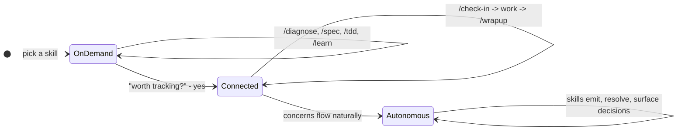

# Contributing

How waypoint-skills works internally.
Read this if you want to understand the architecture, add a skill, or modify the tracking system.

## Process and adapter split

Each skill has two layers:

1. **Process document** (`process/*.md`) - the methodology, tool-agnostic. Works as a human checklist, a team playbook, or an AI instruction set.
2. **Adapter** (`task/{skill}/SKILL.md`, `project/{skill}/SKILL.md`, or `adapters/{tool}/`) - thin file that references the process doc and adds tool-specific execution notes.

| Process document | Methodology | Adapter skills |
|-----------------|-------------|----------------|
| [process/debugging.md](process/debugging.md) | 7-phase debugging discipline | /diagnose |
| [process/requirements.md](process/requirements.md) | Requirements grilling and spec writing | /spec |
| [process/tdd.md](process/tdd.md) | Test-driven development | /tdd |
| [process/architecture-review.md](process/architecture-review.md) | Architecture assessment | /improve-codebase-architecture |
| [process/learning.md](process/learning.md) | Structured technical learning | /learn |

Not every skill has a process doc.
Some are too thin (/grill-me is a 13-line instruction) or too tool-specific (/prototype has three execution branches that depend on the agent model).

## Directory structure

```
task/           # Skills that do work (diagnose, spec, tdd, etc.)
project/        # Skills that manage projects (check-in, wrapup, migrate, etc.)
process/        # Tool-agnostic methodology documents
templates/      # Shared file templates (feature specs, logic docs, glossary)
adapters/       # Platform-specific adapters (cursor, opencode, codex)
internals/      # System design docs (concepts, engagement model)
```

Task skills work standalone with no project context.
Project skills become more useful when project docs (SCOPE.md, CONCERNS.md, etc.) exist.

## Frontmatter Schema

Every `SKILL.md` must declare exactly these required fields:

```yaml
---
name: skill-name                    # Required. Kebab-case.
description: "One-line description" # Required. Used for routing and discovery.
status: stable | draft | experimental  # Required.
user-invocable: true | false        # Optional. Default: true.
---
```

`user-invocable: false` marks a skill that should not be triggered directly by user request or model inference - typically a utility skill that another skill orchestrates internally.
Omit `user-invocable` entirely for the common case where a skill is freely invocable - it defaults to `true`.

All other frontmatter fields (`metadata.hermes`, `inputs`, `outputs`, `signals`, etc.) are optional and skill-specific.
Keep them as needed for routing metadata or workflow bookkeeping.

## SKILL.md body contract

The body is what Claude Code auto-loads on skill invocation.
Every line costs tokens on every invocation, so the body must be lean.

**Line budget:** target 50-80 lines, max 100.
CI warns at >80 and fails at >100.

**Structure:**

```
---
name, description, status
---
Does NOT: {boundary guardrail}.

{Instructions start here. Sequential. No preamble header.}

## {Skill-specific sections only where genuine logical break}

## Engagement
{declaration only - 3-5 lines}

## Exit
{2-4 bullets - handoff targets}

## Tone
{1 sentence}
```

**Rules:**

- No H1 header. Frontmatter `name` + directory is identity.
- No `## On invocation` header. The body runs on invocation - sequential execution is assumed.
- No opening paragraph restating the description. Frontmatter `description` is authoritative.
- Body starts with `Does NOT:` boundary line. Every skill declares what it explicitly won't do.
- `## Tone` is mandatory (1 sentence).
- `## Exit` is mandatory (2-4 bullets) unless the skill has a natural completion message that serves as exit.

## Content ownership

Every piece of instruction content has exactly one authoritative location.
SKILL.md may **declare** (what this skill does differently) but never **define** (restate shared protocol).

| Content type | Authoritative location | SKILL.md contains |
|-------------|----------------------|-------------------|
| Engagement protocol | ENGAGEMENT-REFERENCE.md | Declaration only (emits, writes, override) |
| Skill hints mechanic | CONCEPTS-REFERENCE.md | Integration point ("during Step N") |
| Exit handoffs | SKILL.md | 2-4 bullets, unique per skill |
| Tone | SKILL.md | 1 sentence, mandatory |
| Routing/purpose | Frontmatter description | Nothing restated in body |
| Boundaries | SKILL.md opening line | "Does NOT: {guardrail}" mandatory |

## Directive verbs

How SKILL.md references other files determines whether they're loaded on invocation.

**Skill-specific reference** (reference/*.md, phases/*.md) - imperative directive:
```
Read [reference/priority-stack.md](reference/priority-stack.md) before proposing work.
```
The agent must read the file. Silent degradation risk is too high for optional loading.

**Shared infrastructure** (internals/*.md, process/*.md) - declaration + on-demand:
```
See [ENGAGEMENT-REFERENCE.md](../../internals/ENGAGEMENT-REFERENCE.md) for the full protocol.
```
The agent consults on demand when performing an engagement action, not on every invocation.
This preserves the token savings from engagement deduplication.

## Subfolder convention

Skills with supplementary files organize them into exactly two subfolder types:

| Subfolder | Semantic | When to use |
|-----------|----------|-------------|
| `phases/` | Routed one-at-a-time based on current state | Phase files, wave files, branch files |
| `reference/` | Conditionally loaded material | Priority stacks, format specs, methodology |

Concept-specific names go in the filename, not the directory.
Design's waves become `phases/wave-1-soul.md`.
Prototype's branches become `phases/logic.md`, `phases/ui.md`.
Format specs (ADR, glossary) go in `reference/`.

No other subfolder types (`waves/`, `branches/`, `formats/`).

## Tracking with Concerns

Skills can optionally track what a project doesn't know yet, is assuming, or has identified as wrong - in a single file called `CONCERNS.md`:

```markdown
### C-041 [open] Should status changes require a confirmation dialog?
type: question | raised: 2026-07-18
Legacy app confirms before status transitions. Our rebuild doesn't. Intentional or gap?
```

Four types of concern: **questions** (need a decision), **assumptions** (working theories to validate), **issues** (something looks wrong), **milestones** (checkpoints grouping specs and handoffs).

Skills read from and write to this file. Humans read from and write to this file.
It is a markdown document - no special tooling required.

You don't need CONCERNS.md to use the skills.
Task skills work standalone.
Project skills become more useful when concerns exist to operate on.

See [CONCERNS-FORMAT.md](CONCERNS-FORMAT.md) for the full specification.

## Engagement model

How the system deepens over time:



**On demand** - invoke a skill, it does the work, done. No setup, no project context needed.

**Connected** - a skill discovers something worth remembering across sessions. You say yes, it writes a line to `CONCERNS.md`. Now `/check-in` reads what's open and proposes work. `/wrapup` resolves concerns after implementation. Sessions link together.

**Autonomous** - concerns flow naturally. Skills emit them during work, resolve what they can, and only surface what needs your judgment.

Each stage includes the previous one. Structure accumulates when it helps and stays out of the way when it doesn't.

### Engagement declaration in SKILL.md

The `## Engagement` section in each SKILL.md is a pure declaration - only fields where this skill diverges from the shared protocol:

```markdown
## Engagement
See [ENGAGEMENT-REFERENCE.md](../../internals/ENGAGEMENT-REFERENCE.md) for the full protocol.
Emits: concerns (type: issue, question)
Writes: none
Override: commit-producing skill - follows exit protocol (section 6)
```

3-5 lines per skill. No boilerplate (nudge protocol, concern format, prohibitions, claims check).
Those are shared protocol defined in ENGAGEMENT-REFERENCE.md.

## Multi-phase workflows

/migrate and /buildout have phase tracking for large efforts.
These are optional - you can start with /create and upgrade later.

| Workflow | Phases | When to use |
|----------|--------|-------------|
| /migrate | 7 phases (docs sprint through cutover) | Replacing an existing system |
| /buildout | 4 phases (discovery through iterate-and-ship) | Building a new product |
| /create | No phases | Adding features to an existing codebase |

## Branching

- `main` - stable, deployed via `sync-skills.ps1`. Plugin installs pull from here.
- `revisions` - local development branch. Specs, drafts, and in-progress work live here.

All skill changes land on `main` directly (single contributor, no PR gate).
The `revisions` branch holds design specs (`specs/`) and working drafts that shouldn't ship.

## Local development

Clone the repo:

```bash
git clone git@github.com:max-zhu-bv/waypoint-skills.git
```

Deploy to `~/.claude/`:

```bash
.\sync-skills.ps1
```

The sync script copies skills (flattened from `task/`, `project/`, `in-progress/`, `third-party/` into `~/.claude/skills/`), shared infrastructure (`internals/`, `templates/`, `process/` into `~/.claude/`), and root files (`CONCERNS-FORMAT.md`, `README.md` into `~/.claude/skills/`).

After editing a skill, re-run `sync-skills.ps1` to deploy.
The CI lint check (`lint-skills.sh`) validates SKILL.md line counts: warns >80, fails >100.

## Design references

- [internals/CONCEPTS-REFERENCE.md](internals/CONCEPTS-REFERENCE.md) - Documentation Map, Resolution Cascade, Single-Writer, naming classes
- [internals/ENGAGEMENT-REFERENCE.md](internals/ENGAGEMENT-REFERENCE.md) - Tier detection, nudge protocol, concern emission rules
