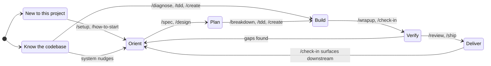
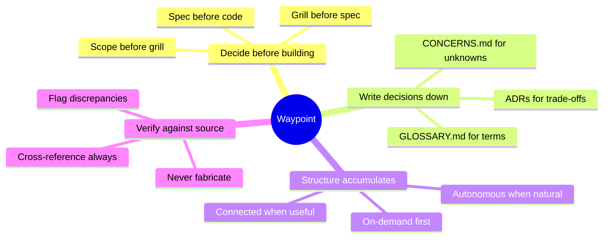

# Waypoint Skills

Understand what you're building before you build it.

Most AI-assisted development starts with a prompt and ends with code.
What's missing is the middle - understanding the system you're changing, deciding what to build before building it, and verifying that what you built matches what you decided.

Waypoint skills enforce that middle by building a durable layer of documentation alongside the code - a glossary of domain terms, ADRs for the trade-offs you settled, specs you can grill, and a running log of open concerns.
Every skill reads that state before acting and writes its decisions back before moving on, so the next session - yours or another agent's - starts from what the last one learned instead of from a blank prompt.
The code is what any tool gives you; the written-down decisions and the context that survives between sessions are what Waypoint adds.

## Getting started

Any skill works standalone - `/diagnose` a bug without project context, `/spec` a feature without a glossary.

But when a skill discovers something worth remembering (a domain term, an assumption, a decision), it offers to write it down.
Say yes and sessions start linking together.
Say no and it moves on.
Structure accumulates when it helps and stays out of the way when it doesn't.

### New to this?

A brand-new project starts with `/setup`.
One scoping grill lays down the documentation the rest of the family reads - scope, a glossary, and the open-questions log - so every later session has something to stand on.

```
you:   /setup

agent: No scaffolding yet - starting fresh. Two phases: scope grill,
       then architecture & standards.

       What problem does this solve, and for whom?
       My read: fixture tracking for charter operators who live in
       spreadsheets today. Right?

you:   yes, and it has to sync with our existing fleet API

agent: Scope for v1:
       In  - fixture list, status tracking, fleet API sync
       Out - invoicing, multi-org, mobile
       Uncertain - who owns the API contract? (decide by Fri)

       Wrote SCOPE.md, seeded _GLOSSARY.md with 6 domain terms, and
       logged the API-contract owner as an open concern.
       Phase 0 gate passed. Next: /check-in reads these back and
       proposes the first task.
```

Not starting fresh? `/how-to-start` reads existing project state and routes you to the right skill.

### Typical daily session

```
you:   /check-in

agent: 8 endpoints and 4 screens remaining. 2 specs ready to build.
       Concerns: 3 issues (oldest: 4 days), 1 assumption unvalidated
       Next: Invite flow - spec is fresh, the mailer service is wired,
       and the API contract is defined. Build now before it drifts.
```

### Speccing a feature

```
you:   /spec notifications

agent: What problem does this solve?
       My read: users have no way to know when something changes without
       manually checking. Notifications close that feedback loop. Right?

you:   yes, in-app and email for mentions and status changes

agent: Scope for v1:
       In - in-app notification feed, email delivery, mention and status
            change triggers, read/unread state, preference toggles
       Out - push notifications, digest batching, custom trigger rules

       Two trade-offs to decide:
       1. Delivery: queue-based (reliable, handles spikes) vs synchronous
          (simpler, one fewer service)?
          Recommend queue - notifications spike on batch operations and
          synchronous delivery blocks the request.
       2. Storage: dedicated notifications table vs append to activity log?
          Recommend dedicated table - different retention, different
          indexes, simpler queries for the feed endpoint.

you:   agree on both, but add a webhook option to the spec too

agent: [writes spec to docs/specs/notifications.md with acceptance criteria]
```

### Debugging a hard bug

```
you:   /diagnose order total wrong after applying a discount code

agent: Building a feedback loop...
       [reproduces: add 3 items, apply 20% code, total shows full price
        but the discount row appears in the breakdown]

       Reproduced. Three hypotheses, ranked:
       1. Discount is calculated but not subtracted in the total query
       2. Total is cached and the cache isn't invalidated on discount apply
       3. Frontend reads the pre-discount total from a stale API response

       Proceed with this ranking?

you:   1 is most likely, we just refactored the pricing module

agent: Testing hypothesis 1. Adding [DEBUG-7c3a] instrumentation to the
       order total calculation...
       [confirms: discount row inserted but SUM query filters by
        line_type = 'item', excluding type = 'discount']

       Fixed. Root cause: the pricing refactor introduced a line_type
       column but the total query still used a hardcoded WHERE clause
       that only summed item rows.
       Regression test at order_pricing_test.py:142.
```

## Install

### Claude Code

**Marketplace plugin** (managed, auto-updates):

```bash
claude plugin marketplace add max-zhu-bv/waypoint-skills
claude plugin install wp@max-zhu-bv
```

Skills are namespaced under the `wp:` prefix, so autocomplete surfaces them as `wp:tdd`, `wp:spec`, and so on:

```
/wp:diagnose tests pass locally but fail in CI
/wp:spec user notifications with email and in-app
/wp:tdd checkout flow with discount codes
```

To update after a new release:

```bash
claude plugin marketplace update max-zhu-bv
claude plugin uninstall wp@max-zhu-bv
claude plugin install wp@max-zhu-bv
```

### OpenCode

OpenCode reads `.claude/skills/` natively, so the Claude Code install works as-is.
For standalone use, copy adapters from `adapters/opencode/` to `.opencode/skills/{name}/SKILL.md`.

### Cursor

Copy adapter files from `adapters/cursor/` to `.cursor/rules/` in your project.
Each `.mdc` file uses Agent Requested activation - Cursor's agent reads the description and applies it when relevant.

### Codex

Add the contents of files in `adapters/codex/` to your project's `AGENTS.md`.
Keep AGENTS.md lean - Codex has a 32KiB combined instruction budget (configurable in `~/.codex/config.toml`).

### No AI

Read the process documents in `process/` directly.
They are the complete methodology without any tool-specific instructions.

## Skills

### Orient

- **[setup](project/setup/SKILL.md)** - Kickoff a project with scoping grill, architecture decisions, and documentation structure.
- **[how-to-start](task/how-to-start/SKILL.md)** - Route to the right skill based on project state and user intent.
- **[check-in](project/check-in/SKILL.md)** - Session authority. Reads concerns, proposes next task, fires checkpoints, and surfaces read-only what is staged-but-unpromoted or blocked downstream. The daily verb.
- **[reorient](project/reorient/SKILL.md)** - Snapshot project state, surface deferred decisions, audit progress. Use when scattered or between milestones.

### Plan

- **[spec](task/spec/SKILL.md)** - Grill scope and acceptance criteria, output a spec file.
- **[breakdown](task/breakdown/SKILL.md)** - Decompose a spec into implementable slices with dependency ordering.
- **[grill-me](task/grill-me/SKILL.md)** - Interview relentlessly about a plan or design until reaching shared understanding on every branch.
- **[grill-with-docs](task/grill-with-docs/SKILL.md)** - Grill a plan against the domain model. Sharpen terminology, update GLOSSARY.md and ADRs as decisions crystallize.
- **[design](project/design/SKILL.md)** - Create and evolve a design system through three waves: Soul, Tokens, Proof.

### Build

- **[tdd](task/tdd/SKILL.md)** - Build features or fix bugs with red-green-refactor. Test-first, behavior-driven.
- **[create](task/create/SKILL.md)** - Add features to an existing codebase. Ensures specs exist and docs stay current. Lighter than /buildout.
- **[diagnose](task/diagnose/SKILL.md)** - Run a disciplined diagnosis loop for hard bugs: reproduce, hypothesize, instrument, fix, regression-test.
- **[prototype](task/prototype/SKILL.md)** - Build throwaway prototypes to flesh out a design. Routes between terminal app, UI variations, or design panel.

### Sustain

- **[wrapup](project/wrapup/SKILL.md)** - Resolve concerns, cascade to shared docs, evaluate gate criteria. Run after /tdd or any implementation verb.
- **[review](task/review/SKILL.md)** - A code critic you point at your work before shipping. Runs a lens (persona), writes a throwaway findings note, routes each finding. Suggested, never forced; never ships.
- **[ship](project/ship/SKILL.md)** - The outbound seam. Assemble a spec-grounded PR and propose an afk/hitl routing; never holds merge authority. Run after /wrapup.
- **[improve-codebase-architecture](task/improve-codebase-architecture/SKILL.md)** - Find deepening opportunities informed by domain language and ADRs. Consolidate modules, improve testability.
- **[learn](task/learn/SKILL.md)** - Learn through any code task with meaningfully different options, trade-off explanations, and terminology bridges.

### Workflows

- **[migrate](project/migrate/SKILL.md)** - Replace an existing system layer by layer until the new application is complete. Extends /setup for migrations.
- **[buildout](project/buildout/SKILL.md)** - Configure greenfield project scope with MoSCoW priorities and phase resolution. Extends /setup.

## How it fits together



Both paths converge.
Skip orientation and jump straight to building, and the skills flag what's missing when it matters - an undefined term, an unchecked assumption, a spec that has drifted from the code - and point you back.

Before you ship, `/review` looks over your work, writes up what it finds, and hands you each item to route: fold it into a spec, break it down, fix it now, or note it for later.
Nothing changes until you decide.
`/wrapup` offers a review on the way out; with no pipeline, it is your last check before done.
`/review` and `/ship` stay separate by design: one gives feedback, the other ships.

Delivery is the outbound seam.
Once a change is verified, `/ship` assembles a spec-grounded PR and proposes an afk (agent-eligible) or hitl (human-in-the-loop) routing - a proposal only; the delivery target holds merge authority, never Waypoint.
Next session, `/check-in` reads back, read-only, what is staged but not promoted and what the pipeline is blocking, then points you there and stops.
There is no promote verb: promotion to production is human-owned.

## Principles



## Changelog

| Version | Change |
|---------|--------|
| 3.0.0 | Breaking: plugin renamed `waypoint-skills` -> `wp` for shorter, autocompletable invocation (`/wp:tdd`). Existing installs do not auto-migrate: run `claude plugin uninstall waypoint-skills@max-zhu-bv` then `claude plugin install wp@max-zhu-bv`. Marketplace add command (`max-zhu-bv/waypoint-skills`) is unchanged. |
| 2.1.0 | Handoff mode in /wrapup (continuity doc + boot prompt for next agent). /port demoted to reference checklist under /migrate. Exit wording sharpened across tdd, review, wrapup. Check-in reads handoff docs. Chain graph labels corrected. Breaking: `/port` no longer invocable by name - use `/migrate` + `/tdd` with the port checklist. |
| 2.0.0 | The quality loop. New skills: /review (persona-based code critic), /ship (outbound PR seam). Chain dispatcher for skill-to-skill handoff. Settings surface with trusted-config model. Engagement reference split into `internals/engagement/` directory. Artifacts manifest emission. Autonomy axis. Persona trust gate (two-tier, user-global only). Prototype skill: taste profile grounding, shell-swap default, HTML artifact output, worktree-scoped design panel with archival. Plugin manifest for marketplace install. |
| 1.0.0 | Initial plugin release. 21 skills. Reference tree restructure (SKILL.md 50-80 lines, CI enforced at 100). Three-tier doc layout. Concerns tracking. Engagement model. Process/adapter split. Structural rules in CONTRIBUTING.md. |

## Contributing

See [CONTRIBUTING.md](CONTRIBUTING.md) for how the system works internally: the process/adapter split, concerns tracking, engagement tiers, and the skill directory structure.

## Skill structure

Each skill is a directory under `task/` or `project/` with a `SKILL.md` that Claude Code auto-loads on invocation.
Supplementary content lives in two optional subfolders:

- **`phases/`** - Files routed one-at-a-time based on current state (phase files, wave files, branch files)
- **`reference/`** - Conditionally loaded material (priority stacks, format specs, checklists)

SKILL.md targets 50-80 lines (max 100, CI enforced).
Content ownership: SKILL.md declares what's different, never restates shared protocol.
See [CONTRIBUTING.md](CONTRIBUTING.md) for the full structural rules.

## Reference

- [CONCERNS-FORMAT.md](CONCERNS-FORMAT.md) - Tracking format specification
- [process/](process/) - Standalone methodology documents (no AI required)
- [templates/](templates/) - Shared file templates (feature specs, logic docs, glossary)
- [adapters/](adapters/) - Cursor, OpenCode, and Codex adapter files
- [internals/](internals/) - System design docs (concepts, engagement model)
