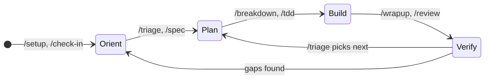
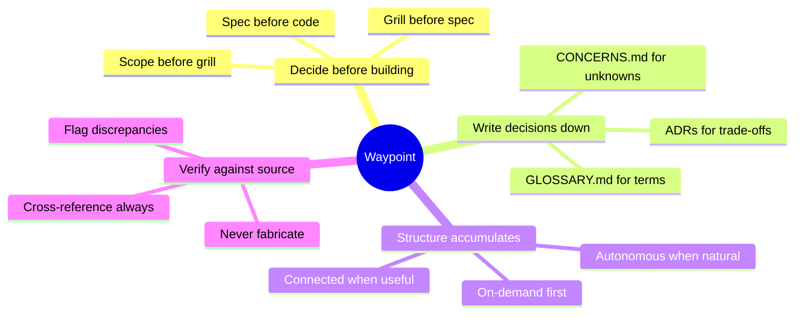

# Waypoint Skills

Understand what you're building before you build it.

Most AI-assisted development starts with a prompt and ends with code.
What's missing is the middle - understanding the system you're changing, deciding what to build before building it, and verifying that what you built matches what you decided.

Waypoint skills enforce that middle.
Every skill reads project state before acting and writes decisions down before moving on.
The result is a codebase where decisions are traceable, specs are grillable, and context survives between sessions.

## Getting started

Any skill works standalone - `/diagnose` a bug without project context, `/spec` a feature without a glossary.

But when a skill discovers something worth remembering (a domain term, an assumption, a decision), it offers to write it down.
Say yes and sessions start linking together.
Say no and it moves on.
Structure accumulates when it helps and stays out of the way when it doesn't.

### New to this?

```
you:   /how-to-start

agent: Read: Project has models, routes, and views but no spec docs.
       What are you trying to do?
       /diagnose for bugs, /spec for features, /tdd to build test-first,
       /design for visual system, /learn to understand something.

you:   I need to add notifications to the app

agent: Read: No spec exists for notifications.
       Recommend: /spec - underspecified feature, nail down requirements
       before building.
       Proceed with /spec?

you:   yes

agent: [invokes /spec with "notifications"]
```

### Typical daily session

```
you:   /check-in

agent: Phase 3 (MVP build). 3 open concerns (1 critical).
       Enterprise: rule catalogue detected, 2 WARN violations in touched area.
       Worktree: 1 stale (feature/old-branch, merged 3 days ago).
       Ready. /triage to pick next task, or tell me what you're working on.

you:   /triage

agent: Read 6 Linear issues. Ranked:
       1. [BUG] Order total wrong after discount - /diagnose
       2. [FEATURE] Notification preferences - needs spec - /spec
       3. [TECH DEBT] Extract shared validation - /tdd direct
       Pick one, or tell me what you're working on.
```

### Speccing a feature

```
you:   /spec notifications

agent: What problem does this solve?
       My read: users have no way to know when something changes without
       manually checking. Notifications close that feedback loop. Right?

you:   yes, in-app and email for mentions and status changes

agent: Scope for v1:
       In - in-app notification feed, email delivery, mention and status
            change triggers, read/unread state, preference toggles
       Out - push notifications, digest batching, custom trigger rules

       Two trade-offs to decide:
       1. Delivery: queue-based (reliable, handles spikes) vs synchronous
          (simpler, one fewer service)?
          Recommend queue - notifications spike on batch operations and
          synchronous delivery blocks the request.
       2. Storage: dedicated notifications table vs append to activity log?
          Recommend dedicated table - different retention, different
          indexes, simpler queries for the feed endpoint.

you:   agree on both, but add a webhook option to the spec too

agent: [writes spec to docs/specs/notifications.md with acceptance criteria]
```

### Debugging a hard bug

```
you:   /diagnose order total wrong after applying a discount code

agent: Building a feedback loop...
       [reproduces: add 3 items, apply 20% code, total shows full price
        but the discount row appears in the breakdown]

       Reproduced. Three hypotheses, ranked:
       1. Discount is calculated but not subtracted in the total query
       2. Total is cached and the cache isn't invalidated on discount apply
       3. Frontend reads the pre-discount total from a stale API response

       Proceed with this ranking?

you:   1 is most likely, we just refactored the pricing module

agent: Testing hypothesis 1. Adding [DEBUG-7c3a] instrumentation to the
       order total calculation...
       [confirms: discount row inserted but SUM query filters by
        line_type = 'item', excluding type = 'discount']

       Fixed. Root cause: the pricing refactor introduced a line_type
       column but the total query still used a hardcoded WHERE clause
       that only summed item rows.
       Regression test at order_pricing_test.py:142.
```

## Install

### Claude Code

**Marketplace plugin** (managed, auto-updates):

```bash
claude plugin marketplace add max-zhu-bv/waypoint-skills
claude plugin install waypoint-skills@max-zhu-bv
```

Then invoke any skill directly:

```
/diagnose tests pass locally but fail in CI
/spec user notifications with email and in-app
/tdd checkout flow with discount codes
```

To update after a new release:

```bash
claude plugin marketplace update max-zhu-bv
claude plugin uninstall waypoint-skills@max-zhu-bv
claude plugin install waypoint-skills@max-zhu-bv
```

### OpenCode

OpenCode reads `.claude/skills/` natively, so the Claude Code install works as-is.
For standalone use, copy adapters from `adapters/opencode/` to `.opencode/skills/{name}/SKILL.md`.

### Cursor

Copy adapter files from `adapters/cursor/` to `.cursor/rules/` in your project.
Each `.mdc` file uses Agent Requested activation - Cursor's agent reads the description and applies it when relevant.

### Codex

Add the contents of files in `adapters/codex/` to your project's `AGENTS.md`.
Keep AGENTS.md lean - Codex has a 32KiB combined instruction budget (configurable in `~/.codex/config.toml`).

### No AI

Read the process documents in `process/` directly.
They are the complete methodology without any tool-specific instructions.

## Skills

### Orient

- **[setup](project/setup/SKILL.md)** - Kickoff a project with scoping grill, architecture decisions, and documentation structure. Handles fresh builds, migrations, and resumptions.
- **[triage](task/triage/SKILL.md)** - Read a backlog (Linear, GitHub, PRs), categorize items, prioritize, and route to the right verb.
- **[how-to-start](task/how-to-start/SKILL.md)** - Route to the right skill based on project state and user intent.
- **[check-in](project/check-in/SKILL.md)** - Context loader. Reads concerns, detects enterprise artefacts, reports worktree state. Use `--deep` for course correction (absorbs former /reorient).

### Plan

- **[spec](task/spec/SKILL.md)** - Grill scope and acceptance criteria, output a spec file (or issue when J1 rules apply).
- **[breakdown](task/breakdown/SKILL.md)** - Decompose a spec into implementable slices with dependency ordering. Scope guard enforces endpoint coverage.
- **[grill-me](task/grill-me/SKILL.md)** - Interview relentlessly about a plan or design until reaching shared understanding on every branch.
- **[grill-with-docs](task/grill-with-docs/SKILL.md)** - Grill a plan against the domain model. Catalogue-driven interrogation when a rule catalogue exists. Sharpen terminology, update GLOSSARY.md and ADRs.

### Build

- **[tdd](task/tdd/SKILL.md)** - Build features or fix bugs with red-green-refactor. Convention enforcement test creation in the refactor step.
- **[diagnose](task/diagnose/SKILL.md)** - Run a disciplined diagnosis loop for hard bugs: reproduce, hypothesize, instrument, fix, regression-test.
- **[prototype](task/prototype/SKILL.md)** - Build throwaway prototypes. Duplicates existing components and wires to a variant switcher for side-by-side comparison.

### Sustain

- **[wrapup](project/wrapup/SKILL.md)** - Resolve concerns, validate scope coverage, cascade to shared docs, evaluate gate criteria.
- **[review](task/review/SKILL.md)** - A code critic. Runs a lens (persona), cross-checks against rule catalogue, writes findings note, routes each finding. Never ships.
- **[learn](task/learn/SKILL.md)** - Learn through any code task with meaningfully different options, trade-off explanations, and terminology bridges.
- **[improve-codebase-architecture](task/improve-codebase-architecture/SKILL.md)** - Find deepening opportunities informed by domain language and ADRs.

### Deprecated

- **[create](task/create/SKILL.md)** - Use triage -> spec -> breakdown -> tdd instead.
- **[buildout](project/buildout/SKILL.md)** - Absorbed into /setup.
- **[migrate](project/migrate/SKILL.md)** - Absorbed into /setup migration mode.
- **[reorient](project/reorient/SKILL.md)** - Absorbed into /check-in --deep.

## How it fits together



The core chain is `triage -> spec -> breakdown -> tdd -> review`.
`/check-in` loads context at session start; `/triage` reads your backlog and routes each item to the right verb.
`/review` cross-checks against the project's rule catalogue when one exists; `/wrapup` validates scope coverage before closing.

## Principles



## Changelog

| Version | Change |
|---------|--------|
| 3.0.0 | JSON-first architecture. Every skill gets `skill.json` (steps, checklists, chain edges, capabilities). SKILL.md reduced to ~20-line bootloader. 7-script test suite replaces lint-skills.sh. Enterprise auto-detect: rule catalogues, endpoint registries, parity systems, scope protection. New: /triage (backlog reader). /check-in repurposed as context loader (absorbs /reorient --deep). /setup absorbs /migrate. /prototype enforces variant switcher. Convention enforcement test creation in /setup + /tdd. Catalogue-driven architecture grill in setup Phase 1. 8 JSON schemas. Breaking: /create, /buildout, /reorient, /migrate deprecated. |
| 2.1.0 | Handoff mode in /wrapup (continuity doc + boot prompt for next agent). /port demoted to reference checklist under /migrate. Exit wording sharpened across tdd, review, wrapup. Check-in reads handoff docs. Chain graph labels corrected. Breaking: `/port` no longer invocable by name - use `/migrate` + `/tdd` with the port checklist. |
| 2.0.0 | The quality loop. New skills: /review (persona-based code critic), /ship (outbound PR seam). Chain dispatcher for skill-to-skill handoff. Settings surface with trusted-config model. Engagement reference split into `internals/engagement/` directory. Artifacts manifest emission. Autonomy axis. Persona trust gate (two-tier, user-global only). Prototype skill: taste profile grounding, shell-swap default, HTML artifact output, worktree-scoped design panel with archival. Plugin manifest for marketplace install. |
| 1.0.0 | Initial plugin release. 21 skills. Reference tree restructure (SKILL.md 50-80 lines, CI enforced at 100). Three-tier doc layout. Concerns tracking. Engagement model. Process/adapter split. Structural rules in CONTRIBUTING.md. |

## Contributing

See [CONTRIBUTING.md](CONTRIBUTING.md) for how the system works internally: the process/adapter split, concerns tracking, engagement tiers, and the skill directory structure.

## Skill structure

Each skill is a directory under `task/` or `project/` with two files:

- **`skill.json`** - Machine-readable source of truth: steps with checklists, chain edges, capabilities, engagement declarations. Validated by `schemas/skill.schema.json` and the test suite.
- **`SKILL.md`** - ~20-line bootloader that Claude Code auto-loads on invocation. Points to skill.json, declares engagement/exit/tone.

Supplementary content:

- **`phases/`** - Files routed one-at-a-time based on current state
- **`reference/`** - Methodology docs loaded during specific steps
- **`schemas/`** - JSON schemas for format validation (glossary, ADR, slice, findings)

See [CONTRIBUTING.md](CONTRIBUTING.md) for the full structural rules and test suite.

## Reference

- [schemas/](schemas/) - JSON schemas for skill validation and output formats
- [tests/](tests/) - 7-script test suite (run: `for t in tests/test-*.sh; do bash "$t"; done`)
- [CONCERNS-FORMAT.md](CONCERNS-FORMAT.md) - Tracking format specification
- [process/](process/) - Standalone methodology documents (no AI required)
- [templates/](templates/) - Shared file templates
- [adapters/](adapters/) - Cursor, OpenCode, and Codex adapter files
- [internals/](internals/) - System design docs (concepts, engagement model, chain)
