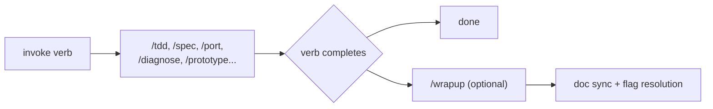
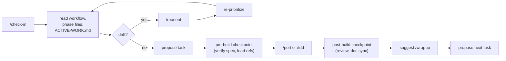

# Waypoint Skills

A skill family for building software products with AI agents.
Two layers: invoke a verb for single-session work, or set up a project for multi-session continuity.

## Getting Started

Install the plugin, then invoke any skill directly - no setup required.

```bash
npx claude-plugins install waypoint-skills
```

**Task layer** (single-session work): invoke a verb and go.

```
/tdd CreateVessel         # test-driven build
/spec VesselParticulars   # grill requirements, output spec
/diagnose flaky-test      # disciplined debug loop
```

**Project layer** (multi-session work): run /project-setup once, pick a workflow, then /check-in each session.

```
/project-setup            # architecture, docs, CLAUDE.md, conventions
/migrate                  # or /buildout, or /create
/check-in                 # every session after that
```

/project-setup writes a Documentation Map to CLAUDE.md so every skill knows where things live:

```
| Concept              | Path             | Status |
|----------------------|------------------|--------|
| Domain glossary      | CONTEXT.md       | Active |
| Naming conventions   | CONVENTIONS.md   | Active |
| Scope boundaries     | SCOPE.md         | Active |
```

Skills look up "Naming conventions" in the map instead of hardcoding `CONVENTIONS.md`.
When a project grows, /project-setup can be re-run to restructure (e.g., split CONVENTIONS.md into a conventions/ folder) - the map updates, skills follow automatically.

`docs/local/` is the gitignored working state for questions, assumptions, and handoffs.
See [LOCAL-DOCS-REFERENCE.md](project-setup/LOCAL-DOCS-REFERENCE.md) for structure and scaling rules.

## Design Keywords

Four properties that shape how every skill behaves:

- **Memoized** - decisions stick. You told /project-setup your test runner is Vitest? It writes that to CLAUDE.md and never asks again - even if you re-run setup, even if a different agent session picks up the project.

- **Reentrant** - re-running is safe. Your project outgrew flat config files? Re-run /project-setup. It reads what exists, keeps your answers, and only asks about the new structure. No "start over" path.

- **Self-healing** - broken references get caught. Someone deletes CONVENTIONS.md? Next /check-in notices the Documentation Map points to a missing file and offers to fix it.

- **Bias to action** - skills should just work. If /spec can infer the naming convention from existing code, it uses it and shows what it chose. Questions are reserved for genuine forks where either path is reasonable and the wrong one wastes real work.

### Decision gates

When a skill does ask a question, two conventions keep the flow natural:

**Conversational fallback:** if you pick "Other" and write something like "I'm not sure, what would you recommend?", the agent drops into discussion - explains trade-offs, talks through the options. When you're ready, it re-presents the original question.

**Learn-mode elaboration:** if you ask "what does that mean?", the agent gives a short explainer scoped to the specific decision (a few key terms, one further reading link), then re-presents the question.

## Two-Layer Model

**Project layer** - for work that spans multiple sessions.
Run /project-setup once, pick a workflow (/migrate, /buildout, or /create), then /check-in at the start of every session.
/check-in reads a workflow record from CLAUDE.md so it knows where you left off without asking.

**Task layer** - for one-and-done work.
Invoke any verb directly: `/tdd`, `/spec`, `/diagnose`, `/learn`, etc.
No setup required. If project docs exist, skills use them. If not, they still work - you just don't get cross-referencing or convention enforcement.

**Bridge skills** (marked `*` in the Skill Map) live in both layers.
Example: `/spec` is a task-layer verb - you can run `/spec UserProfile` with zero setup and get a grilled spec.
But if SCOPE.md and CONVENTIONS.md exist, `/spec` also cross-references scope boundaries and enforces naming patterns.

Rule of thumb: if you need progress tracked across sessions, use the project layer. Otherwise, invoke verbs directly.

## Skill Map

### User-invoked

```
PROJECT SETUP
  /project-setup          Foundation: architecture, docs, CLAUDE.md, conventions

WORKFLOWS (pick one)
  /migrate                Replace an existing system layer by layer
  /buildout               Build a new product from scratch
  /create*                Add features to an existing codebase

SESSION
  /check-in               Orient, propose next task, fire checkpoints

IMPLEMENTATION
  /tdd                    Test-driven: define behavior, test first, build to satisfy
  /port                   Migration: capture current behavior, replicate, verify parity

TRACKER
  /to-issues*             Convert specs/plans to tracker issues
  /triage*                Triage and prioritize backlog

SUPPORTING
  /spec*                  Grill requirements, output spec file
  /wrapup                 Resolve flags, spec drift check, cascade to shared docs
  /grill-with-docs        Architecture decisions that meet the ADR threshold
  /reorient               Strategic course correction, axis audit, re-prioritize
  /learn                  Trade-off exploration with options, terms, quiz
  /prototype*             Quick validation mockup
  /diagnose               Disciplined debug loop for hard bugs
  /grill-me               Open-ended interview on any plan or decision
  /author-skill           Guided skill authoring with Waypoint conventions
  /improve-codebase-architecture  Surface architectural friction, propose deepening

* = bridge skill (task-layer core, project-layer integration)
```

### Model-invoked

```
  chrome-devtools-axi     Browser automation via Chrome DevTools
  find-skills             Skill discovery and installation from the ecosystem
```

## Session Flows

### Task session



### Project session



## Glossary

**Active Workflow** - a record /migrate, /buildout, or /create writes to CLAUDE.md: "we're migrating a VMS frontend, currently in Phase 4."
/check-in reads it next session and picks up where you left off.

**Bridge skill** - a verb that works alone but gets smarter with project docs (marked `*` in the Skill Map).
Example: `/spec` grills requirements either way, but when SCOPE.md exists, it also checks whether the feature is in scope.

**Checkpoint** - a validation step inside phase files: what triggers it, what files to check against, what to do, and what "pass" looks like.
Example: "before building, verify the spec covers all source system fields."

**Documentation Map** - the table in CLAUDE.md that tells skills where files live.
/check-in uses it to detect missing files (e.g., map says "Naming conventions -> CONVENTIONS.md" but the file was deleted).

**Naming classes** - file suffix convention: `FOO.md` (user-facing), `FOO-REFERENCE.md` (skill-internal), `FOO-FORMAT.md` (template).

**Resolution cascade** - when a spec disagrees with the code: (1) read the source of truth, (2) write a test to prove which side is right, (3) only ask the human if both are ambiguous.

**Single-writer** - only /wrapup edits content docs (CONVENTIONS.md, CONTEXT.md).
Other skills flag what should change; /wrapup makes the edits.
Machine-readable state in CLAUDE.md has per-section owners (e.g., /project-setup owns the Documentation Map).

See [CONCEPTS-REFERENCE.md](CONCEPTS-REFERENCE.md) for extended definitions and the full write-ownership table.

## Phase Overview

Phase systems belong to the project layer.
Task-layer skills have no phases.

### Migration (/migrate)

| Phase | Name | Verb | Key Checkpoint |
|-------|------|------|----------------|
| 0-1 | Setup | /project-setup + /migrate | - |
| 2 | Documentation Sprint | manual | Gate: every entity spec'd |
| 3 | Vertical Slice | /port | Pre-build spec check, post-slice architecture grill |
| 4 | Horizontal Buildout | /port | Pre-build spec prerequisite, post-build review + doc sync |
| 5 | Integration | /port | Pre-wire dependency + shape check, post-wire review |
| 6a | Functional Validation | manual | Post-validation review per screen |
| 6b | Design System + UX | /prototype | See migrate/REFERENCES.md for design phase details |
| 7 | Cutover | manual | Ship checklist |

### Buildout (/buildout)

| Phase | Name | Verb | Key Checkpoint |
|-------|------|------|----------------|
| 0-1 | Setup | /project-setup + /buildout | Project intake |
| 2 | Discovery & Validation | /spec | Gate: persona, MoSCoW, specs |
| 3 | MVP Build | /tdd | Pre-build spec check, post-slice architecture grill |
| 4 | Iterate & Ship | /tdd | Pre-build for new Must, design consolidation |
| - | Design System | - | After Phase 3 gate; see buildout/REFERENCES.md |
