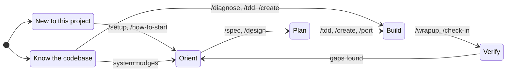

# Waypoint Skills

Understand what you're building before you build it.

Most AI-assisted development starts with a prompt and ends with code.
What's missing is the middle: understanding the system you're changing, deciding what to build before building it, and verifying that what you built matches what you decided.
Waypoint skills enforce that middle.
Every skill reads project state before acting and writes decisions down before moving on.

## Install

### Claude Code

**Plugin** (managed, auto-updates):

```bash
claude plugin install --source https://github.com/max-zhu-bv/waypoint-skills
```

**skills.sh** (copies into your project, editable):

```bash
npx skills add max-zhu-bv/waypoint-skills
```

Either way, invoke any skill directly:

```
/diagnose flaky-test
/spec VesselParticulars
/tdd CreateVessel
```

### OpenCode

OpenCode reads `.claude/skills/` natively, so the Claude Code install works as-is.
For standalone use, copy adapters from `adapters/opencode/` to `.opencode/skills/{name}/SKILL.md`.

### Cursor

Copy adapter files from `adapters/cursor/` to `.cursor/rules/` in your project.
Each `.mdc` file uses Agent Requested activation - Cursor's agent reads the description and applies it when relevant.

### Codex

Add the contents of files in `adapters/codex/` to your project's `AGENTS.md`.
Keep AGENTS.md lean - Codex has a 32KiB combined instruction budget (configurable in `~/.codex/config.toml`).

### No AI

Read the process documents in `process/` directly.
They are the complete methodology without any tool-specific instructions.

## What does this look like?

### Not sure where to start

```
you:   /how-to-start

agent: Read: Project setup, no active workflow.
       What are you trying to do?
       /diagnose for bugs, /spec for features, /tdd to build test-first,
       /design for visual system, /learn to understand something.
       /find-skills to browse everything.

you:   I need to add a news feed widget to the dashboard

agent: Read: No spec exists for news feed.
       Recommend: /spec - underspecified feature, nail down requirements
       before building.
       Proceed with /spec?

you:   yes

agent: [invokes /spec with "news feed widget"]
```

### Starting a work session

```
you:   /check-in

agent: Phase 5 (Integration). 12 screens remaining.
       Concerns: 3 flags (oldest: 4 days), 2 questions pending BE team
       Next: Wire Claims list to real API - endpoint exists but FE still
       hits mock. Recommend this because the contract is fresh and field
       mappings should be verified now, not after they drift.
```

### Speccing a new feature

```
you:   /spec news feed widget

agent: What problem does this solve?
       My read: operators check 3 shipping news sites separately during
       morning review. A dashboard widget saves that tab-switching.
       Right?

you:   yes, RSS feeds from industry sources

agent: Scope for v1:
       In - RSS parsing, 3 feed sources, configurable refresh interval
       Out - user-added feeds, search within articles, bookmarks

       Two trade-offs to decide:
       1. Refresh: poll on an interval (simple) vs server-push (real-time)?
          Recommend polling - shipping news is hourly, not second-by-second.
       2. Parse server-side (Azure Function) or client-side (browser fetch)?
          Recommend server-side - avoids CORS, caches across users.

you:   agree on both, but refresh should be every 15 min not hourly

agent: [writes spec to docs/specs/news-feed-widget.md with acceptance criteria]
```

### Debugging a hard bug

```
you:   /diagnose login page throws 401 after token refresh

agent: Building a feedback loop. Running the auth flow in the browser...
       [reproduces the bug in 3 seconds]

       Reproduced. Three hypotheses, ranked:
       1. Token refresh returns a new token but the interceptor still sends the cached one
       2. Refresh endpoint CORS preflight fails silently in production
       3. Refresh token itself has expired (clock skew)

       Proceed with this ranking?

you:   1 is most likely, we just changed the token cache layer

agent: Testing hypothesis 1. Adding [DEBUG-a4f2] instrumentation to the
       interceptor...
       [confirms stale cache, writes regression test, fixes, cleans up]

       Fixed. Root cause: token cache was keyed by URL, new refresh endpoint
       returns a different URL. Regression test at auth.spec.ts:142.
```

## Starting points

| You're thinking... | Start here |
|-------------------|------------|
| "I have a thing, not sure where to start" | `/how-to-start` |
| "I just joined this project" | `/setup` |
| "What should I work on?" | `/check-in` |
| "I've lost the plot" | `/reorient` |
| "We're replacing a legacy system" | `/setup` then `/migrate` |
| "We're building something new" | `/setup` then `/buildout` |
| "This needs a design system" | `/design` |
| "I need to build a thing" | `/spec` then `/tdd` |
| "Just add this feature" | `/create` |
| "This is broken" | `/diagnose` |
| "I want to understand X" | `/learn` |

## Skills

### Orient

| Skill | What it does |
|-------|-------------|
| `/setup` | One-time project setup: scope, conventions, doc structure |
| `/how-to-start` | Context-aware skill router: reads project state, recommends the right skill |
| `/check-in` | Start-of-session: reads project state, proposes next task |
| `/reorient` | Course correction: audits progress, surfaces deferred decisions |

### Plan

| Skill | What it does |
|-------|-------------|
| `/spec` | Grill requirements, output spec with acceptance criteria |
| `/design` | Design system creation: soul-finding, token architecture, proof screens |
| `/grill-me` | Open-ended interview on any plan or decision |
| `/grill-with-docs` | Architecture decisions that meet the ADR threshold |

### Build

| Skill | What it does |
|-------|-------------|
| `/tdd` | Test-driven build: plan slices, tracer bullet, incremental red-green-refactor |
| `/create` | Add a feature end-to-end: spec, build, wrapup |
| `/port` | Migrate a screen from a legacy system: read source, build, verify parity |
| `/prototype` | Quick throwaway mockup to validate an idea |
| `/migrate` | Multi-phase workflow for replacing a legacy system |
| `/buildout` | Multi-phase workflow for building a new product |

### Sustain

| Skill | What it does |
|-------|-------------|
| `/wrapup` | End-of-task: resolves discrepancies, updates shared docs |
| `/improve-codebase-architecture` | Surface architectural friction, propose improvements |
| `/learn` | Explore a topic with options, terminology bridging, quiz |

## How it fits together



Both paths lead to the same place.
If you skip orientation and jump to building, the system catches gaps and nudges you back when it matters - missing domain glossary, unresolved assumptions, specs that drifted from the code.

**You don't have to set up everything.**
Any skill works standalone - `/diagnose` a bug without project context, `/spec` a feature without a glossary.
But when a skill discovers something worth remembering (a domain term, an assumption, a decision), it offers to write it down.
Say yes and sessions start linking together.
Say no and it moves on.
Structure accumulates when it helps and stays out of the way when it doesn't.

## Contributing

See [CONTRIBUTING.md](CONTRIBUTING.md) for how the system works internally: the process/adapter split, concerns tracking, engagement tiers, and the skill directory structure.

## Reference

- [CONCERNS-FORMAT.md](CONCERNS-FORMAT.md) - Tracking format specification
- [process/](process/) - Standalone methodology documents (no AI required)
- [adapters/](adapters/) - Cursor, OpenCode, and Codex adapter files
