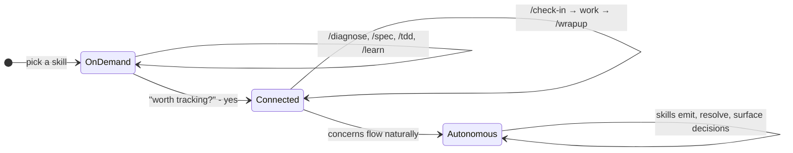

# Waypoint Skills

Structured methodologies for the tasks that eat your day - debugging, writing specs, test-driven builds, architecture review, project planning.
Each one is a step-by-step process you can follow on paper, with an AI assistant, or fully automated.

## What does this look like?

### Debugging a hard bug

```
you:   /diagnose login page throws 401 after token refresh

agent: Building a feedback loop. Running the auth flow in the browser...
       [reproduces the bug in 3 seconds]

       Reproduced. Three hypotheses, ranked:
       1. Token refresh returns a new token but the interceptor still sends the cached one
       2. Refresh endpoint CORS preflight fails silently in production
       3. Refresh token itself has expired (clock skew)

       Proceed with this ranking?

you:   1 is most likely, we just changed the token cache layer

agent: Testing hypothesis 1. Adding [DEBUG-a4f2] instrumentation to the
       interceptor...
       [confirms stale cache, writes regression test, fixes, cleans up]

       Fixed. Root cause: token cache was keyed by URL, new refresh endpoint
       returns a different URL. Regression test at auth.spec.ts:142.
```

### Speccing a new feature

```
you:   /spec news feed widget

agent: What problem does this solve?
       My read: operators check 3 shipping news sites separately during
       morning review. A dashboard widget saves that tab-switching.
       Right?

you:   yes, RSS feeds from industry sources

agent: Scope for v1:
       In - RSS parsing, 3 feed sources, configurable refresh interval
       Out - user-added feeds, search within articles, bookmarks

       Two trade-offs to decide:
       1. Refresh: poll on an interval (simple) vs server-push (real-time)?
          Recommend polling - shipping news is hourly, not second-by-second.
       2. Parse server-side (Azure Function) or client-side (browser fetch)?
          Recommend server-side - avoids CORS, caches across users.

you:   agree on both, but refresh should be every 15 min not hourly

agent: [writes spec to docs/specs/news-feed-widget.md with acceptance criteria]
```

### Starting a work session

```
you:   /check-in

agent: Phase 5 (Integration). 12 screens remaining.
       Concerns: 3 flags (oldest: 4 days), 2 questions pending BE team
       Next: Wire Claims list to real API - endpoint exists but FE still
       hits mock. Recommend this because the contract is fresh and field
       mappings should be verified now, not after they drift.
```

## How usage evolves



**On demand** - invoke a skill, it does the work, done. No setup, no project context needed.

**Connected** - a skill discovers something worth remembering across sessions. You say yes, it writes a line to `CONCERNS.md`. Now `/check-in` reads what's open and proposes work. `/wrapup` resolves concerns after implementation. Sessions link together.

**Autonomous** - concerns flow naturally. Skills emit them during work, resolve what they can, and only surface what needs your judgment.

Each stage includes the previous one. Structure accumulates when it helps and stays out of the way when it doesn't.

## Starting points

| You're thinking... | Start here |
|-------------------|------------|
| "This is broken" | `/diagnose` |
| "I need to build a thing" | `/spec` then `/tdd` |
| "We're replacing a legacy system" | `/project-setup` then `/migrate` |
| "We're building something new" | `/project-setup` then `/buildout` |
| "What should I work on?" | `/check-in` |
| "I've lost the plot" | `/reorient` |
| "I want to understand X" | `/learn` |
| "Just add this feature" | `/create` |

## Install

### Claude Code

```bash
npx skills add max-zhu-bv/waypoint-skills
```

Invoke any skill directly:

```
/diagnose flaky-test
/spec VesselParticulars
/tdd CreateVessel
```

### OpenCode

OpenCode reads `.claude/skills/` natively, so the Claude Code install works as-is.
For standalone use, copy adapters from `adapters/opencode/` to `.opencode/skills/{name}/SKILL.md`.

### Cursor

Copy adapter files from `adapters/cursor/` to `.cursor/rules/` in your project.
Each `.mdc` file uses Agent Requested activation - Cursor's agent reads the description and applies it when relevant.

### Codex

Add the contents of files in `adapters/codex/` to your project's `AGENTS.md`.
Keep AGENTS.md lean - Codex has a 32KiB combined instruction budget (configurable in `~/.codex/config.toml`).

### No AI

Read the process documents in `process/` directly.
They are the complete methodology without any tool-specific instructions.

---

## How it works

Everything below is for people who want to understand the internals - how skills are structured, how tracking works, and how to extend the system.

### Process and adapter split

Each skill has two layers:

1. **Process document** (`process/*.md`) - the methodology, tool-agnostic. Works as a human checklist, a team playbook, or an AI instruction set.
2. **Adapter** (`{skill}/SKILL.md` or `adapters/{tool}/`) - thin file that references the process doc and adds tool-specific execution notes.

| Process document | Methodology | Adapter skills |
|-----------------|-------------|----------------|
| [process/debugging.md](process/debugging.md) | 7-phase debugging discipline | /diagnose |
| [process/requirements.md](process/requirements.md) | Requirements grilling and spec writing | /spec |
| [process/tdd.md](process/tdd.md) | Test-driven development | /tdd |
| [process/architecture-review.md](process/architecture-review.md) | Architecture assessment | /improve-codebase-architecture |
| [process/learning.md](process/learning.md) | Structured technical learning | /learn |

Not every skill has a process doc.
Some are too thin (/grill-me is a 13-line instruction) or too tool-specific (/prototype has three execution branches that depend on the agent model).

### Tracking with Concerns

Skills can optionally track what a project doesn't know yet, is assuming, or has flagged as wrong - in a single file called `CONCERNS.md`:

```markdown
### C-041 [open] Should vessel status transitions require confirmation?
type: question | raised: 2026-07-18
WPF app has a confirmation dialog. Our implementation doesn't. Intentional or gap?
```

Three types of concern: **questions** (need a decision), **assumptions** (working theories to validate), **flags** (something looks wrong).

Skills read from and write to this file. Humans read from and write to this file.
It is a markdown document - no special tooling required.

You don't need CONCERNS.md to use the skills.
Task skills (/diagnose, /spec, /tdd) work standalone.
Project skills (/check-in, /wrapup, /reorient) become more useful when concerns exist to operate on.

See [CONCERNS-FORMAT.md](CONCERNS-FORMAT.md) for the full specification.

### On demand, connected, autonomous

The state diagram above describes a natural progression, not a setting.
On demand: invoke a skill, it works. Connected: CONCERNS.md links sessions. Autonomous: skills handle the bookkeeping.

Decisions persist across sessions. Re-running a skill is always safe (it reads what exists and picks up where it left off). If something breaks - a referenced file gets deleted, a spec drifts from the code - the next skill invocation catches it and offers to fix it.

### Multi-phase workflows

/migrate and /buildout have phase tracking for large efforts.
These are optional - you can start with /create and upgrade later.

| Workflow | Phases | When to use |
|----------|--------|-------------|
| /migrate | 7 phases (docs sprint through cutover) | Replacing an existing system |
| /buildout | 4 phases (discovery through iterate-and-ship) | Building a new product |
| /create | No phases | Adding features to an existing codebase |

### Full skill list

**Task skills:**

| Skill | What it does |
|-------|-------------|
| `/diagnose` | Structured debugging: feedback loop, hypothesize, instrument, fix, regression test |
| `/spec` | Grill requirements, output spec with acceptance criteria |
| `/tdd` | Test-driven build: plan slices, tracer bullet, incremental red-green-refactor |
| `/port` | Migrate a screen from a legacy system: read source, build, verify parity |
| `/grill-me` | Open-ended interview on any plan or decision |
| `/grill-with-docs` | Architecture decisions that meet the ADR threshold |
| `/improve-codebase-architecture` | Surface architectural friction, propose improvements |
| `/learn` | Explore a topic with options, terminology bridging, quiz |
| `/prototype` | Quick throwaway mockup to validate an idea |
| `/create` | Add a feature end-to-end: spec, build, wrapup |

**Project skills:**

| Skill | What it does |
|-------|-------------|
| `/check-in` | Start-of-session: reads project state, proposes next task |
| `/wrapup` | End-of-task: resolves discrepancies, updates shared docs |
| `/reorient` | Course correction: audits progress, surfaces deferred decisions |
| `/project-setup` | One-time: establishes scope, conventions, doc structure |
| `/migrate` | Multi-phase workflow for replacing a legacy system |
| `/buildout` | Multi-phase workflow for building a new product |

### Reference

- [CONCERNS-FORMAT.md](CONCERNS-FORMAT.md) - Tracking format specification
- [CONCEPTS-REFERENCE.md](CONCEPTS-REFERENCE.md) - Documentation Map, Resolution Cascade, Single-Writer, naming classes
- [ENGAGEMENT-REFERENCE.md](ENGAGEMENT-REFERENCE.md) - Tier detection, nudge protocol, concern emission rules
- [adapters/](adapters/) - Cursor, OpenCode, and Codex adapter files
- [process/](process/) - Standalone methodology documents
