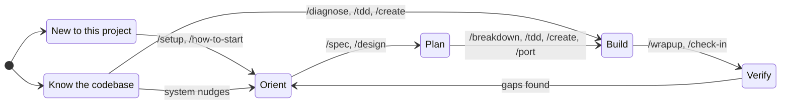
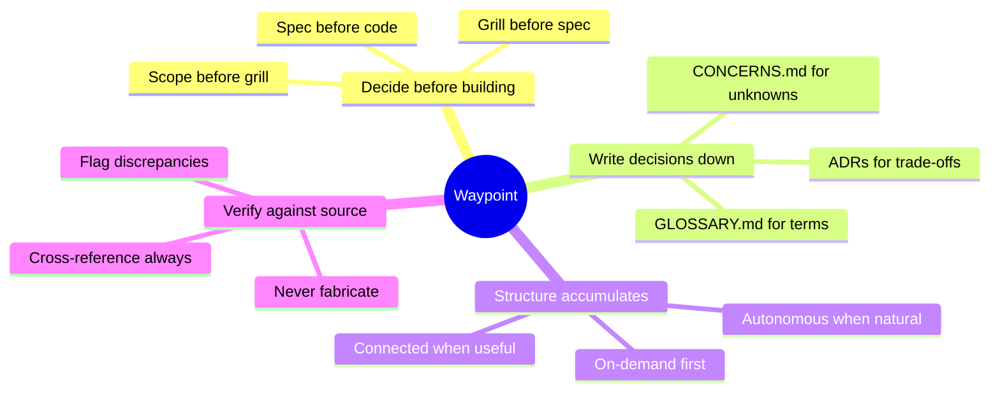

# Waypoint Skills

Understand what you're building before you build it.

Most AI-assisted development starts with a prompt and ends with code.
What's missing is the middle - understanding the system you're changing, deciding what to build before building it, and verifying that what you built matches what you decided.

Waypoint skills enforce that middle.
Every skill reads project state before acting and writes decisions down before moving on.
The result is a codebase where decisions are traceable, specs are grillable, and context survives between sessions.

## Getting started

Any skill works standalone - `/diagnose` a bug without project context, `/spec` a feature without a glossary.

But when a skill discovers something worth remembering (a domain term, an assumption, a decision), it offers to write it down.
Say yes and sessions start linking together.
Say no and it moves on.
Structure accumulates when it helps and stays out of the way when it doesn't.

### New to this?

```
you:   /how-to-start

agent: Read: Project setup, no active workflow.
       What are you trying to do?
       /diagnose for bugs, /spec for features, /tdd to build test-first,
       /design for visual system, /learn to understand something.

you:   I need to add a news feed widget to the dashboard

agent: Read: No spec exists for news feed.
       Recommend: /spec - underspecified feature, nail down requirements
       before building.
       Proceed with /spec?

you:   yes

agent: [invokes /spec with "news feed widget"]
```

### Typical daily session

```
you:   /check-in

agent: Phase 5 (Integration). 12 screens remaining.
       Concerns: 3 issues (oldest: 4 days), 2 questions pending BE team
       Next: Wire Claims list to real API - endpoint exists but FE still
       hits mock. Recommend this because the contract is fresh and field
       mappings should be verified now, not after they drift.
```

### Speccing a feature

```
you:   /spec news feed widget

agent: What problem does this solve?
       My read: operators check 3 shipping news sites separately during
       morning review. A dashboard widget saves that tab-switching.
       Right?

you:   yes, RSS feeds from industry sources

agent: Scope for v1:
       In - RSS parsing, 3 feed sources, configurable refresh interval
       Out - user-added feeds, search within articles, bookmarks

       Two trade-offs to decide:
       1. Refresh: poll on an interval (simple) vs server-push (real-time)?
          Recommend polling - shipping news is hourly, not second-by-second.
       2. Parse server-side (Azure Function) or client-side (browser fetch)?
          Recommend server-side - avoids CORS, caches across users.

you:   agree on both, but refresh should be every 15 min not hourly

agent: [writes spec to docs/specs/news-feed-widget.md with acceptance criteria]
```

### Debugging a hard bug

```
you:   /diagnose login page throws 401 after token refresh

agent: Building a feedback loop. Running the auth flow in the browser...
       [reproduces the bug in 3 seconds]

       Reproduced. Three hypotheses, ranked:
       1. Token refresh returns a new token but the interceptor still
          sends the cached one
       2. Refresh endpoint CORS preflight fails silently in production
       3. Refresh token itself has expired (clock skew)

       Proceed with this ranking?

you:   1 is most likely, we just changed the token cache layer

agent: Testing hypothesis 1. Adding [DEBUG-a4f2] instrumentation to the
       interceptor...
       [confirms stale cache, writes regression test, fixes, cleans up]

       Fixed. Root cause: token cache was keyed by URL, new refresh
       endpoint returns a different URL.
       Regression test at auth.spec.ts:142.
```

## Install

### Claude Code

**Plugin** (managed, auto-updates):

```bash
claude plugin install --source https://github.com/max-zhu-bv/waypoint-skills
```

**skills.sh** (copies into your project, editable):

```bash
npx skills add max-zhu-bv/waypoint-skills
```

Either way, invoke any skill directly:

```
/diagnose flaky-test
/spec VesselParticulars
/tdd CreateVessel
```

### OpenCode

OpenCode reads `.claude/skills/` natively, so the Claude Code install works as-is.
For standalone use, copy adapters from `adapters/opencode/` to `.opencode/skills/{name}/SKILL.md`.

### Cursor

Copy adapter files from `adapters/cursor/` to `.cursor/rules/` in your project.
Each `.mdc` file uses Agent Requested activation - Cursor's agent reads the description and applies it when relevant.

### Codex

Add the contents of files in `adapters/codex/` to your project's `AGENTS.md`.
Keep AGENTS.md lean - Codex has a 32KiB combined instruction budget (configurable in `~/.codex/config.toml`).

### No AI

Read the process documents in `process/` directly.
They are the complete methodology without any tool-specific instructions.

## Skills

### Orient

- **[setup](project/setup/SKILL.md)** - Project kickoff: scoping grill, architecture decisions, doc structure, CLAUDE.md generation. The foundation every other skill builds on.
- **[how-to-start](task/how-to-start/SKILL.md)** - Context-aware skill router. Reads project state, classifies intent, recommends the right skill with a one-line reason.
- **[check-in](project/check-in/SKILL.md)** - Session authority. Reads concerns, proposes next task, fires checkpoints. The daily verb.
- **[reorient](project/reorient/SKILL.md)** - Strategic course correction. Snapshots real project state, surfaces deferred decisions, audits progress. Use when scattered or between milestones.

### Plan

- **[spec](task/spec/SKILL.md)** - Grill requirements until they're precise, then write a spec with acceptance criteria. The gateway to building anything non-trivial.
- **[breakdown](task/breakdown/SKILL.md)** - Decompose a spec into implementable slices with dependency ordering. Each slice maps to one TDD cycle.
- **[grill-me](task/grill-me/SKILL.md)** - Open-ended interview on any plan or decision. Walk down each branch of the design tree, resolving dependencies one by one.
- **[grill-with-docs](task/grill-with-docs/SKILL.md)** - Grilling session that challenges your plan against the existing domain model, sharpens terminology, and updates GLOSSARY.md and ADRs inline.
- **[design](project/design/SKILL.md)** - Design system creation in three waves: Soul (product verb, emotional range, competitive audit), Tokens (color, type, spacing, motion), Proof (real screens stress-tested against the tokens).

### Build

- **[tdd](task/tdd/SKILL.md)** - Test-driven development with red-green-refactor loop. Plans slices, fires a tracer bullet, then builds incrementally.
- **[create](task/create/SKILL.md)** - Add a feature end-to-end: spec, build, wrapup. Lighter than /buildout, structured enough to keep docs current.
- **[port](task/port/SKILL.md)** - Migration implementation verb. Reads spec, logic doc, and source system, briefs subagents, reviews output, flags discrepancies.
- **[diagnose](task/diagnose/SKILL.md)** - Disciplined diagnosis loop: reproduce, minimise, hypothesise, instrument, fix, regression-test. For hard bugs and performance regressions.
- **[prototype](task/prototype/SKILL.md)** - Quick throwaway mockup. Routes between a terminal app (state/logic questions), UI variations (toggleable from one route), or a persistent design panel (visual exploration).

### Sustain

- **[wrapup](project/wrapup/SKILL.md)** - Completion verb. Resolves concerns from implementation, cascades to shared docs, evaluates gate criteria.
- **[improve-codebase-architecture](task/improve-codebase-architecture/SKILL.md)** - Surface architectural friction informed by the domain glossary and ADRs. Propose improvements, don't just list problems.
- **[learn](task/learn/SKILL.md)** - Learning-oriented approach to any code task. Presents meaningfully different options with trade-off explanations and terminology bridging.

### Workflows

- **[migrate](project/migrate/SKILL.md)** - Replace an existing system layer by layer across 7 phases (docs sprint through cutover). One-time setup extending /setup, then /check-in drives daily sessions.
- **[buildout](project/buildout/SKILL.md)** - Build a new product across 4 phases (discovery through iterate-and-ship). MoSCoW structure, phase resolution, validation depth tuning.

## How it fits together



Both paths lead to the same place.
If you skip orientation and jump to building, the system catches gaps and nudges you back when it matters - missing domain glossary, unresolved assumptions, specs that drifted from the code.

## Principles



## Changelog

| Version | Change |
|---------|--------|
| v2.1 | Naming convention picker in /setup (underscore-prefixed vs clean names). Root-level docs/ enforcement. |
| v2.0 | Three-tier doc layout (program/ + implementation/ + _local/). CONTEXT.md renamed to _GLOSSARY.md. Concern type `flag` renamed to `issue`. `deadline:` renamed to `validate-by:`. |
| v1.0 | Initial release. 20 skills, concerns tracking, engagement model, process/adapter split. |

## Contributing

See [CONTRIBUTING.md](CONTRIBUTING.md) for how the system works internally: the process/adapter split, concerns tracking, engagement tiers, and the skill directory structure.

## Reference

- [CONCERNS-FORMAT.md](CONCERNS-FORMAT.md) - Tracking format specification
- [process/](process/) - Standalone methodology documents (no AI required)
- [adapters/](adapters/) - Cursor, OpenCode, and Codex adapter files
- [internals/](internals/) - System design docs (concepts, engagement model)
